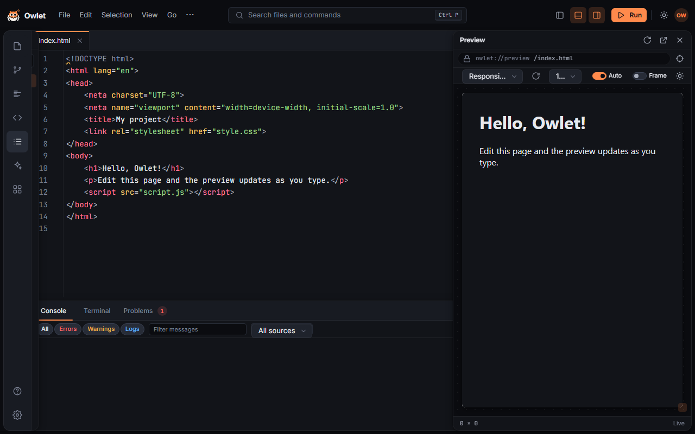

<p align="center"></p>

# Owlet

**A beginner-friendly, offline-first web IDE for learning web development — pure HTML/CSS/JS, zero build step.**

> Formerly known as DevPad. Made by [BrixoByte](https://github.com/BrixoByte).

[Live Demo](https://brixobyte.github.io/Owlet/) · [Report Bug](https://github.com/BrixoByte/Owlet/issues) · [Request Feature](https://github.com/BrixoByte/Owlet/issues)

[](LICENSE)
[](../../pulls)


> **v0.1 beta:** HTML/CSS/JS projects, the multi-file workspace, live preview, console, save/reload, folder and ZIP import, and ZIP export. Everything else is labelled *Preview / Coming soon* in the app.

## Why Owlet?

Owlet is a lightweight, easy-to-use code editor designed specifically for beginners learning HTML, CSS, and JavaScript. Unlike complex IDEs, Owlet offers a simple, intuitive interface where you can:

- Write code and see results instantly
- Learn web development basics without getting overwhelmed
- Practice in a beginner-friendly environment
- Focus on learning without technical setup



## Features

### Core (always free, works offline)
- **Multi-file workspace** — file tree sidebar with folders, tabs, unsaved indicators
- **Instant live preview** — multi-file projects rendered in a sandboxed iframe via Blob URLs
- **Console panel** — `console.log`, warnings, and runtime errors captured from the preview
- **Real-time linting** — ESLint (JS), HTMLHint (HTML), csstree (CSS)
- **Auto-suggest** — code hints while you type
- **Local folder editing** — open and save a real folder via the File System Access API (Chromium)
- **Python support** — real CPython via Pyodide, runs entirely in your browser
- **Offline terminal** — file commands, a JS REPL, and a Python REPL
- **PWA** — installable, airplane-mode capable after first load

### Optional (bring your own free key — BYOK)
- **Cloud sandboxes** — connect a free Daytona / E2B / Modal / Upstash Box account for a real Node.js + bash terminal
- **Multi-language compiler** — run C++, Java, Rust, Go via a configurable compiler API

API keys are stored only in your browser's `localStorage` and are sent only to the provider you choose. There is no backend.

## Getting Started

### All You Need
- A modern web browser (Chrome, Firefox, Safari, Edge)
- Internet connection

### Quick Start
```bash
git clone https://github.com/BrixoByte/Owlet.git
cd Owlet
start index.html   # or just drag index.html into your browser
```

Or serve it (required for the PWA/offline-install features):

```bash
npx serve .        # or python -m http.server
```

### First Steps
1. Open Owlet in your browser
2. Create a file in the sidebar (`index.html`, `style.css`, `script.js`)
3. Type — live preview, linting, and suggestions update as you go
4. Press `Ctrl+S` to save
5. Open the terminal with `` Ctrl+` `` and try `help`

## Tech Stack

| Piece | Library (CDN only) |
|---|---|
| Editor | [CodeMirror 5](https://codemirror.net/5/) |
| Terminal | [xterm.js](https://xtermjs.org/) |
| Python | [Pyodide](https://pyodide.org/) |
| JS lint | [ESLint](https://eslint.org/) (browser build) |
| HTML lint | [HTMLHint](https://htmlhint.com/) |
| CSS lint | [css-tree](https://github.com/csstree/csstree) |
| Exports | [JSZip](https://stuk.github.io/jszip/) |

## Project Structure

```
index.html
css/style.css        minimal functional styling
js/
  app.js             bootstrap + toolbar/status wiring
  state.js           single source of truth (files, tabs, events)
  storage.js         localStorage + File System Access backends
  filetree.js        sidebar file tree
  tabs.js            editor tab bar
  editor.js          CodeMirror wrapper (modes, hints, lint glue)
  preview.js         multi-file preview via Blob URLs
  console.js         console/error panel
  lint.js            ESLint / HTMLHint / csstree wiring
  python.js          Pyodide loader + runner
  terminal.js        xterm.js + pluggable engines
  sandbox.js         BYOK cloud sandbox adapters
  compiler.js        BYOK compiler API adapters
sw.js, manifest.json PWA/offline support
```

## Keyboard Shortcuts

<!-- shortcuts:start -->
| Shortcut | Action | Group |
|---|---|---|
| `Ctrl+S` | Save the active file | General |
| `Ctrl+P` | Command palette / Go to file | General |
| `Ctrl+W` | Close the active tab | General |
| `Esc` | Close menus and dialogs | General |
| `?` | Open the help dialog | General |
| `Ctrl+Z` | Undo | Editor |
| `Ctrl+Y` | Redo | Editor |
| `Ctrl+A` | Select all | Editor |
| `Ctrl+D` | Delete line | Editor |
| `Ctrl+Enter` | Insert line below | Editor |
| `Ctrl+B` | Toggle explorer | View & panels |
| `Ctrl+J` | Toggle bottom panel | View & panels |
| `` Ctrl+` `` | Toggle terminal | View & panels |
| `Alt+R` | Refresh preview | View & panels |
<!-- shortcuts:end -->

## Known Issues (v0.1 beta)

- **Preview-labelled features do nothing yet:** branch switcher, notifications, share/invite chip, and account menu show a "not connected yet" notice only.
- **Not verified for this beta:** terminal, cloud sandbox, Python, compiler API, share links, clone, settings controls, offline mode, mobile layout and screen-reader support.
- **Lint needs a connection once:** ESLint, HTMLHint and CSS lint load from a CDN on first use.

Report anything else in [Issues](../../issues) using the bug template.

## Cloud Sandbox Proxy (optional)

Some sandbox providers block direct browser calls (CORS). If a "Test connection" fails
with a network error, deploy this ~20-line Cloudflare Worker (free tier) and paste its
URL into **Settings → Proxy URL**:

```javascript
export default {
  async fetch(request) {
    const target = new URL(request.url).searchParams.get('url');
    if (!target) return new Response('missing ?url=', { status: 400 });
    const res = await fetch(target, {
      method: request.method,
      headers: request.headers,
      body: ['GET', 'HEAD'].includes(request.method) ? undefined : await request.arrayBuffer(),
    });
    return new Response(res.body, { status: res.status, headers: res.headers });
  },
};
```

## Future

- **Tauri desktop app** — the same frontend wrapped in Rust for a native terminal and full file-system access (see `roadmap.md`).
- **Optional share backend** — only if project sharing becomes a requirement.

## 🤝 Contributing

We welcome contributions! Please see our [Contributing Guidelines](CONTRIBUTING.md) for details.

1. Fork the repository
2. Create your feature branch (`git checkout -b feature/AmazingFeature`)
3. Commit your changes (`git commit -m 'Add some AmazingFeature'`)
4. Push to the branch (`git push origin feature/AmazingFeature`)
5. Open a Pull Request

## 📄 License

This project is licensed under the MIT License - see the [LICENSE](LICENSE) file for details.

## 🙏 Acknowledgments

- [CodeMirror](https://codemirror.net/) for the editor foundation
- [xterm.js](https://xtermjs.org/) and [Pyodide](https://pyodide.org/) teams
- The open source community

---

_Built with ❤️ by [BrixoByte](https://github.com/BrixoByte)_
